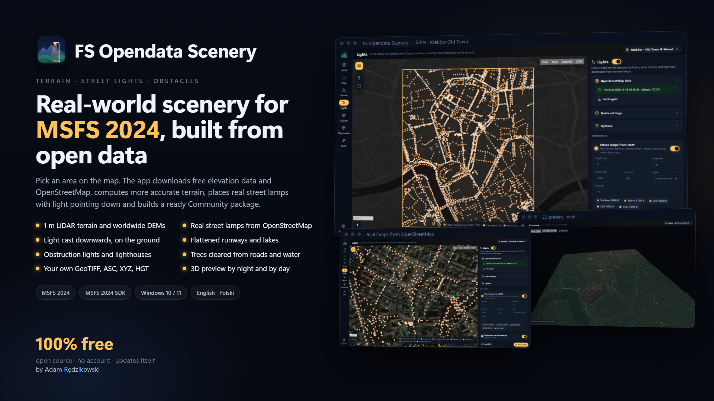

# FS Opendata Scenery



Generator scenerii z otwartych danych dla **Microsoft Flight Simulator 2024**. Wyznaczasz obszar na mapie, a aplikacja pobiera darmowe dane wysokościowe i OpenStreetMap, liczy dokładniejszą rzeźbę terenu, rozstawia prawdziwe latarnie ze światłem skierowanym w dół, dodaje światła przeszkodowe i latarnie morskie, usuwa drzewa z dróg i wód, a na koniec kompiluje gotowy pakiet do folderu **Community**.

*English summary: an open-data scenery generator for MSFS 2024 – better terrain from free DEMs (1 m LiDAR in Poland, AWS Terrain Tiles, Copernicus, your own GeoTIFF/ASC/XYZ/HGT), real street lighting from OpenStreetMap, obstruction lights, lighthouses and tree removal, compiled into a Community package with the MSFS 2024 SDK. The UI is available in Polish and English.*

## Co potrafi

**Obszar**
- prostokąt, wielokąt, okrąg, bieżący widok mapy, okrąg wokół lotniska (ICAO, baza OurAirports),
- wyszukiwarka miejscowości z obrysem administracyjnym (Nominatim),
- import KML, GeoJSON, GPX i WKT; edycja wierzchołków przeciąganiem.

**Teren**
- źródła w ustalanej kolejności (w każdym punkcie wygrywa pierwsze z danymi):
  - **NMT GUGiK 1 m** – cała Polska, LiDAR, pobierany na bieżąco przez WCS Geoportalu,
  - **AWS Terrain Tiles** – cały świat (SRTM, EU-DEM, USGS 3DEP, LiDAR UK, Austria, Norwegia, NZ),
  - **Copernicus GLO-30 / GLO-90**,
  - **własne pliki**: GeoTIFF, ESRI ASCII Grid, XYZ, SRTM HGT, także w ZIP,
  - **własna usługa WCS 1.0**,
- układy współrzędnych bez GDAL: WGS 84, Web Mercator, PL-1992, PL-2000 (strefy 5–8), UTM / ETRS89-UTM, SWEREF99, ETRS-TM35FIN, D96/TM, NZTM, szwajcarskie LV95/LV03, holenderskie RD, British National Grid; rozpoznawanie z GeoTIFF i plików `.prj`,
- siatka prostokątów z heightmapą (`<Rectangle><Heightmap/>`) bez szwów, krok 1–30 m, łagodne przejście (falloff), priorytet,
- wygładzanie bez szwów, przesunięcie pionowe, spłaszczanie jezior i stawów z OSM, pomijanie płaskich kafli i morza,
- **wyrównywanie pasów startowych** z OSM: profil podłużny dopasowany do osi pasa, poprzecznie płasko, łagodne przejście na pobocza i za progi – LiDAR bez garbów pod kołami,
- podgląd z cieniowaniem na mapie, profil wysokości, statystyki i udział źródeł,
- eksport policzonego terenu do **GeoTIFF** (WGS 84, float32) do QGIS i innych narzędzi,
- pamięć podręczna pobranych danych z podglądem rozmiaru i czyszczeniem.

**Światła**
- prawdziwe latarnie z OSM (`highway=street_lamp`): wysokość z tagów, mocowanie (wysięgnik, parkowa, kinkiet, podwieszana, naświetlacz), barwa (sód, LED, rtęć), wysięgnik obrócony nad najbliższą jezdnię,
- oświetlone drogi (`lit=*`) z rozstawem, wysokością i stroną zależnymi od klasy drogi; opcjonalne zgadywanie oświetlenia w zabudowie; bez dublowania lamp z OSM i bez słupów na jezdni,
- parkingi (siatka masztów), boiska i stadiony (maszty w narożnikach z naświetlaczami pochylonymi na płytę), perony, stacje paliw, pomosty,
- chodniki i ścieżki wzdłuż oświetlonych ulic korzystają z ich latarni – bez podwójnych rzędów słupów,
- lampy stawiane ręcznie, wykluczanie pojedynczych lamp z OSM, eksport do GeoJSON,
- **pakiet testowy do kalibracji**: po trzy lampy każdej kategorii, światło przeszkodowe i latarnia morska w jednym małym pakiecie – sprawdzasz jasność i kierunek w symulatorze w minutę,
- każda kategoria z własną wysokością, rozstawem, barwą (K), natężeniem, stożkiem, wyglądem, wysięgnikiem.

**Obiekty**
- światła przeszkodowe na masztach, kominach, wieżach, turbinach wiatrowych (wysokość piasty), dźwigach i słupach – stałe lub błyskające, z poziomami pośrednimi,
- latarnie morskie z barwą, okresem i charakterystyką błysków z tagów `seamark:*`,
- opcjonalny prosty model turbiny wiatrowej,
- wielokąty usuwające drzewa autogenu z dróg, torów, wód, pasów startowych, boisk i parkingów.

**Pakiet**
- proceduralne modele glTF (`ASOBO_macro_light` skierowane w dół, oprawy świecące tylko nocą, dwa poziomy szczegółów),
- obiekty `altitudeIsAgl` przyklejone do terenu – także do nowej rzeźby,
- projekt MSFS 2024 SDK (definicja pakietu, XML scenerii, biblioteka modeli, miniatura), kompilacja `fspackagetool.exe` z dziennikiem na żywo,
- instalacja w Community (kopia albo łącze katalogu), odinstalowanie, ZIP do udostępnienia, eksport i import projektu,
- podgląd 3D terenu i świateł nocą i w dzień,
- lista pakietów zainstalowanych w Community (własnych i testowych) na pulpicie, z usuwaniem,
- przewodnik przy pierwszym uruchomieniu, cofanie zmian obszaru (Ctrl+Z).

**Jak w FS Addon Toolkit**: aktualizacje przez redzikowski.com (instalator i wersja przenośna), zgłaszanie błędów i sugestii, raporty awarii, motywy ciemny/jasny/AMOLED z akcentami, polski i angielski.

## Wymagania

- Windows 10/11 z WebView2,
- **Microsoft Flight Simulator 2024** i **MSFS 2024 SDK** do kompilacji pakietów (SDK pobierzesz w symulatorze: Developer Mode → Help → SDK Installer). Bez SDK aplikacja zapisuje kompletne źródła projektu do kompilacji w Developer Mode.
- Kompilacja uruchamia symulator w tle – MSFS musi być wtedy zamknięty.

## Budowanie ze źródeł

```bash
npm ci
npm run vendor
npx tauri build
```

Testy: `cargo test` w `src-tauri` (testy sieciowe: `cargo test -- --ignored`).

## Licencja i dane

Kod: MIT. Biblioteki: Leaflet (BSD-2), three.js (MIT), ikony Lucide (ISC).
Dane: © współtwórcy OpenStreetMap (ODbL), GUGiK, Copernicus DEM (© DLR e.V., © Airbus Defence and Space, ESA), AWS Terrain Tiles (Mapzen / AWS Open Data), OurAirports (domena publiczna).

Autor: Adam Rędzikowski · [redzikowski.com](https://redzikowski.com)
